# Music DNA

Music DNA is a music player that helps you find out which parts of a song you like, and why.

While a song plays, you mark the part you like (for example 0:08 to 0:20) and pick what you liked about it: the singing, the melody, the rhythm, the build-up. The app saves these parts. After a while it shows you which things you pick most often.

It can also analyse the song itself and show its sections, chords, loudness and frequencies.

Everything runs on your own computer. Your music is not uploaded anywhere.

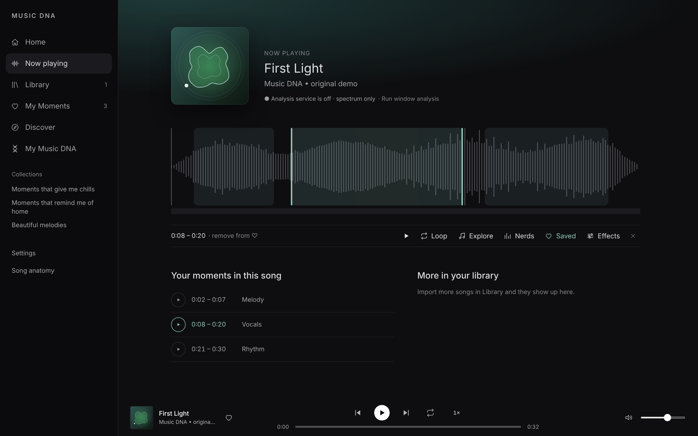

## How you use it

1. Add a song (MP3, WAV and other common formats). A short demo recording is included.
2. Play it. Drag the mouse across the waveform to mark the part you like.
3. Press **Save** and pick what stood out.
4. Open **My Music DNA** to see what you pick most.
5. Press **Explore** on any part to see what is happening in the music there.

## The idea

Music apps recommend whole songs, based on what many other people played. Music DNA works on something smaller and more personal: the 10 or 20 seconds inside a song that you go back to. The question is whether a program can learn what those seconds have in common *for you*, and then find more of them.

It does this in four steps.

### 1. Cut every song into short pieces

Each song is cut into pieces of 12 seconds, with a new piece starting every 6 seconds. A 4-minute song gives about 40 pieces. Everything below is done per piece, not per song.

### 2. Describe each piece with numbers

A computer cannot compare sounds directly, so each piece is turned into lists of numbers. Two kinds are used:

- **Measurements we can name.** 25 numbers such as how loud it is, how bright it is, how busy the rhythm is, how the notes are spread. These come from the audio library librosa.
- **A general "how it sounds" description.** A model called **CLAP** (made by LAION, trained on a very large amount of audio) listens to the piece and gives back a long list of numbers. Two pieces that sound alike get similar lists, even if we cannot say in words why.

Other models add detail that you see in the Explore and Song anatomy screens:

| Model | What it is used for |
| --- | --- |
| CLAP | The general description of how a piece sounds. Used for finding similar pieces. |
| librosa | Loudness, brightness, key, chords, rhythm measurements. |
| Beat This! | Finds the beats and bars. |
| Demucs | Splits a song into vocals, drums, bass and the rest. |
| FCPE / pYIN | Follows the pitch of the voice, including slides and vibrato. |
| Whisper (optional) | Writes down the lyrics from the vocal track. |
| MERT, CultureMERT (research only) | Other "how it sounds" models, tried in the research. Their licence does not allow commercial use, so the player does not depend on them. |

All of these run on your own computer.

### 3. Collect what you tell it

The app treats your actions differently depending on how sure they are:

- **Saving a part** is the strongest signal. You chose it.
- **"I like it" / "Not for me"** on a suggestion is a clear yes or no.
- **Rewinding or looping** is only a hint. The app may ask "you came back to this, do you want to save it?" It does not count as liking until you say yes.
- **Practising** (playing something slowed down, or looping for a long time) is ignored. That is studying a passage, not enjoying it.

### 4. Learn your taste from those examples

Each listener gets their own small model. It is trained in the browser, on your examples only.

For any piece you have not heard yet, the model looks at how similar it is to each piece you liked and each piece you rejected. It learns how much each of your examples should count, and gives two answers: how likely you are to like this piece, and how sure it is.

Three details matter:

- **It learns which kind of similarity matters for you.** For one person, the pieces they save share a general sound (CLAP). For another, they share energy and brightness (the named measurements). The model works out the mix per listener instead of using a fixed one.
- **It works with likes only.** Most people save things and rarely press "Not for me". So pieces from your library that you never marked are used as weak "probably not" examples.
- **It asks where it is unsure.** The pieces it is least sure about are the most useful ones to ask you about. The research studio lists them first (see the last screenshot on this page).

With only a few saved parts the model is marked as experimental, and the app says so.

### What it deliberately does not do

It does not try to detect your emotions. "This passage is sad" and "you like this passage" are different questions, and the app only tries to answer the second. The labels in My Music DNA are the ones you picked yourself.

### What the research has found so far

The Python code in `musicdna/` tests these ideas on real data: 120 songs in 15 genres, using the public "most replayed" curve of each video as a rough sign of which parts people return to. This is research only; that data is not used in the player.

Honest results so far:

- Where a part sits in the song explains most of it. Replays rise, peak 30–50% of the way through, then fall. This has to be removed before the sound can be judged.
- After that, the models pick the more replayed of two parts about 66% of the time. A simple rule ("the brighter part wins") gets 61%. Guessing gets 50%.
- We expected that measurements made for South Asian, Arabic and Turkish music (notes between the Western notes, slides, the drone) would help on that music. On a fresh set of 85 songs they did not: the result was the same with and without them.

The full notes, including the failed tests, are in [docs/RESEARCH_LOG.md](docs/RESEARCH_LOG.md).

## The screens

### Now playing

The picture at the top of this page. The grey shape is the song's loudness over time. The three shaded areas are parts that were saved. Under it is the list of saved parts for this song.

### Explore

Mark a part and press **Explore**. You see the key and tempo, which section of the song it is in, the chords under it, and a picture of its frequencies (low notes at the bottom, high notes at the top).

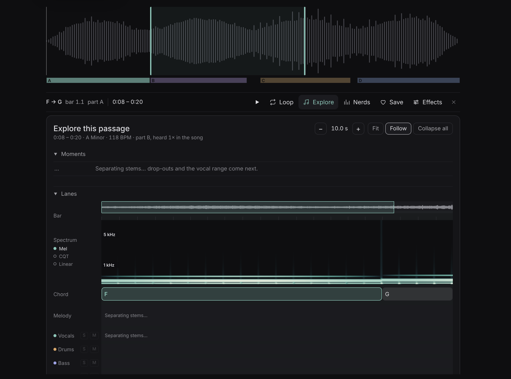

### Stats for nerds

More numbers for the same part: the raw waveform, the frequency picture, the bitrate of the file, and the loudness curve.

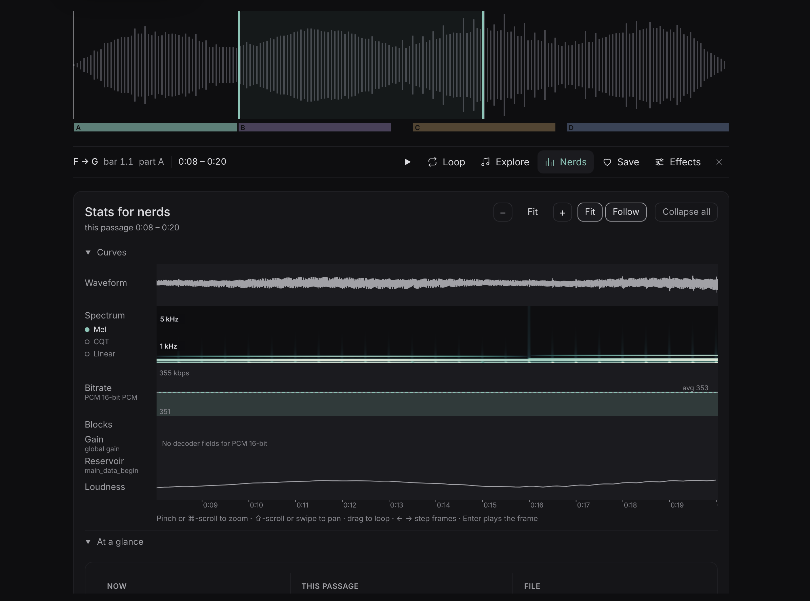

### Song anatomy

The whole song on one line. The coloured blocks A, B, C, D are the sections the app found. Under them are the frequencies and the loudness.

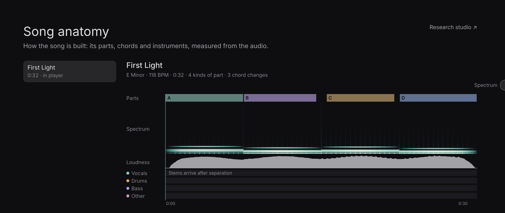

### My Moments

All the parts you saved, with the labels you gave them. You can play one, or play all of them one after another.

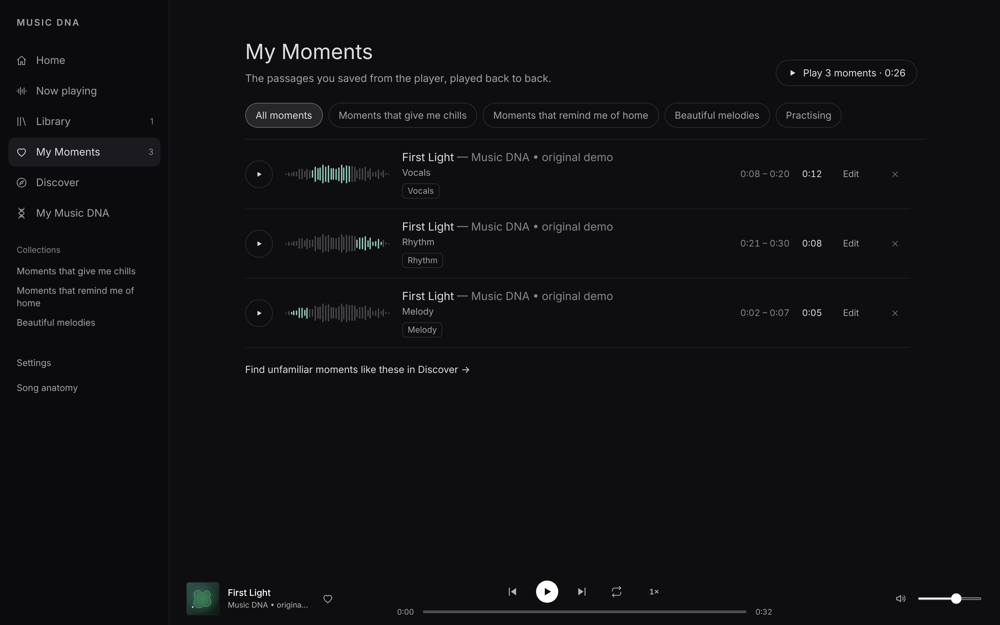

### My Music DNA

This counts the labels you gave. Here three parts were saved and labelled, so the ring shows how they are shared between vocals and melody. The app only counts what you picked yourself. It does not guess your feelings.

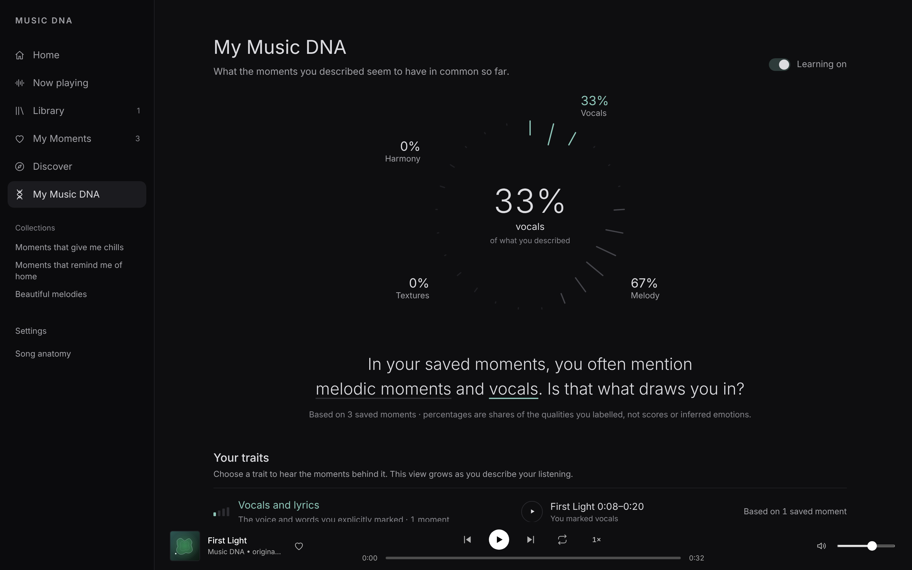

### Discover

Once a song has been analysed, the app looks for other parts that sound similar to the ones you saved and suggests them. You answer **I like it** or **Not for me**, and it uses that for the next suggestions.

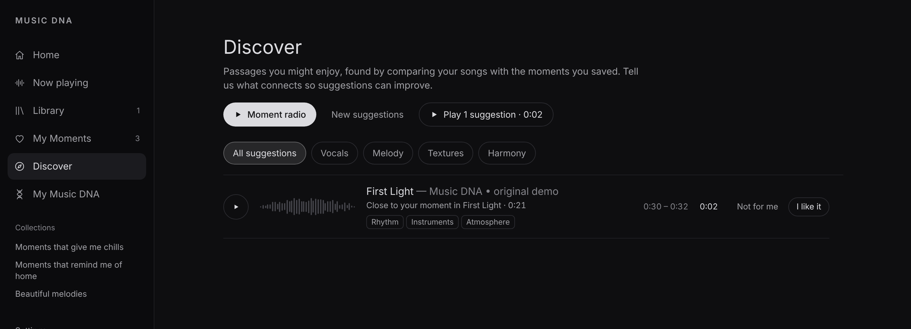

### Effects

Change how the song sounds: concert hall, late night, slowed down, old radio and more, with sliders for echo, bass, treble, pitch and speed.

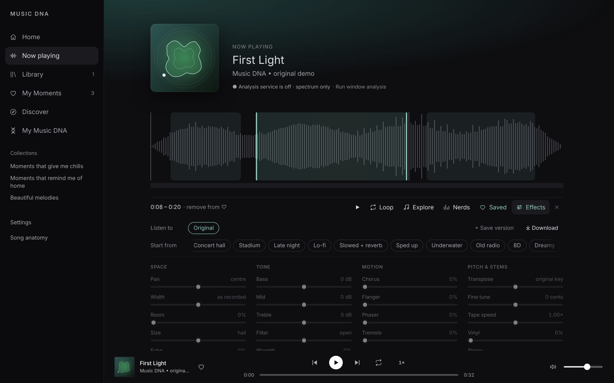

### Home

Your songs and the parts you saved most recently.

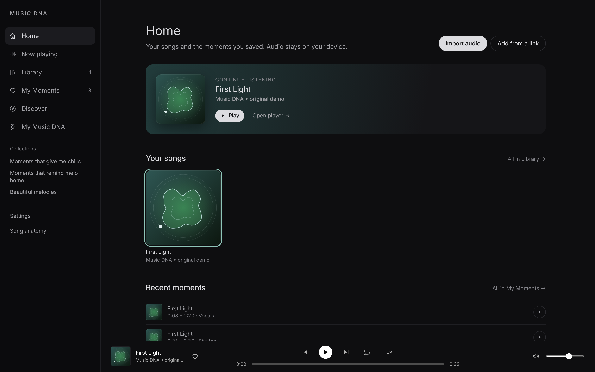

## The research screens

A second app, the research studio, shows the measurements in more detail. It is for studying the music, not for everyday listening.

The song's frequencies over time (top) and how its loudness and tone change (below):

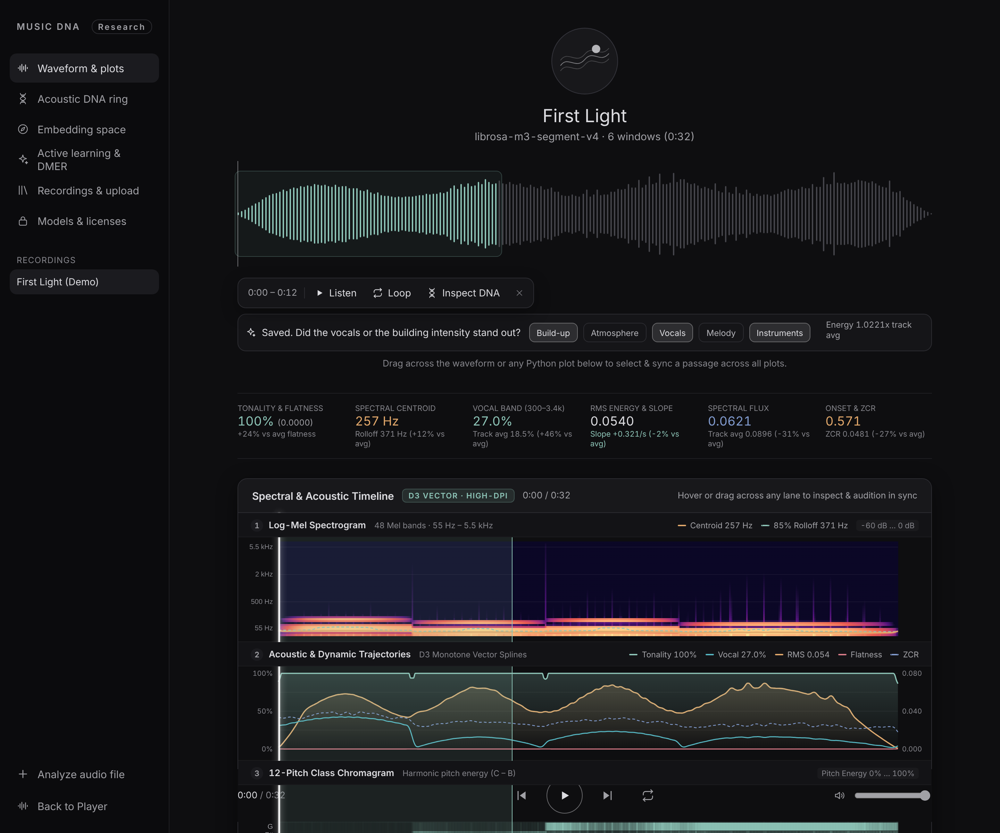

Which of the 12 notes are being played at each moment, and how the sound colour changes:

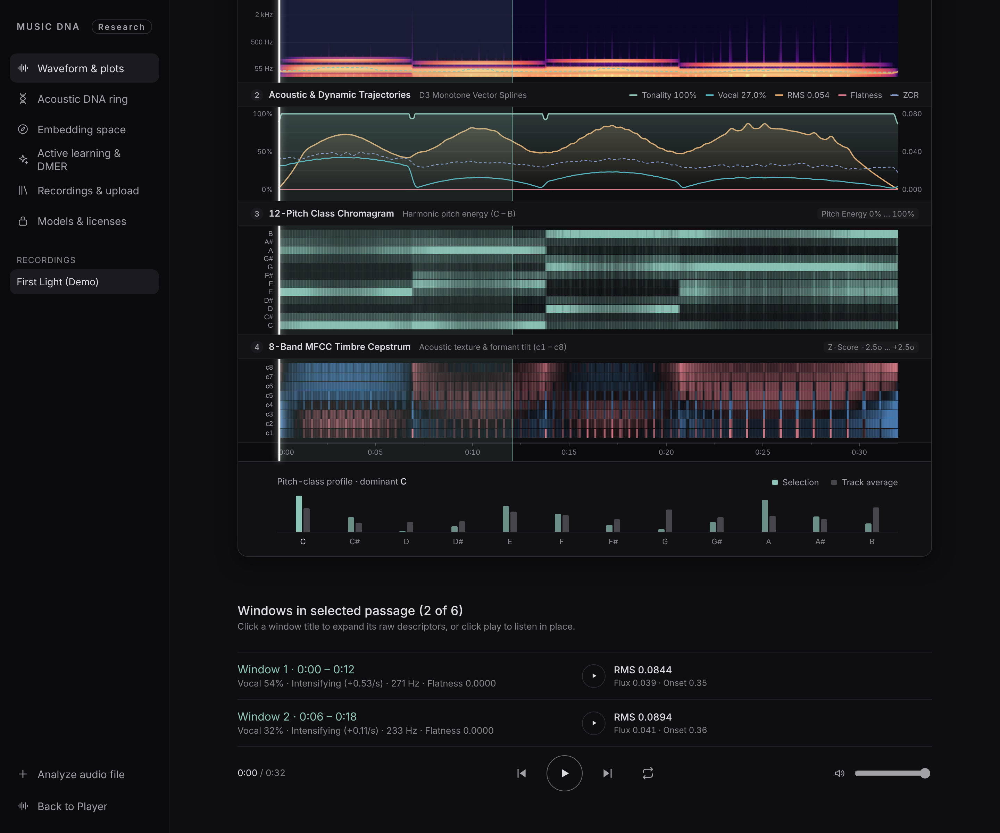

An estimate of which instruments are present, and scores for vocals, melody, rhythm and texture:

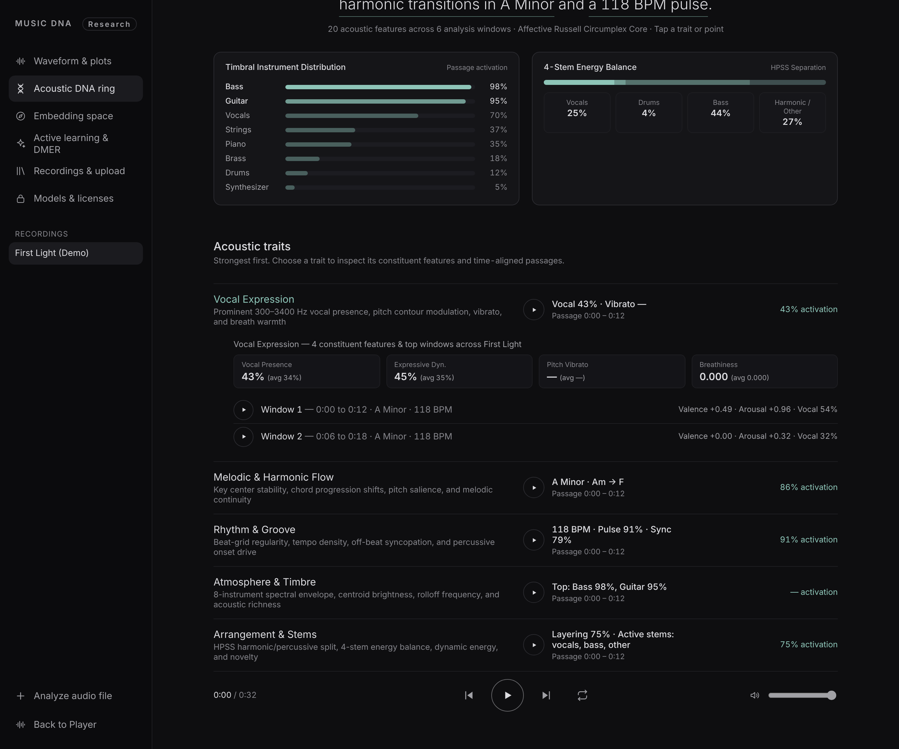

How similar each part of the song is to the first part, listed from most to least similar:

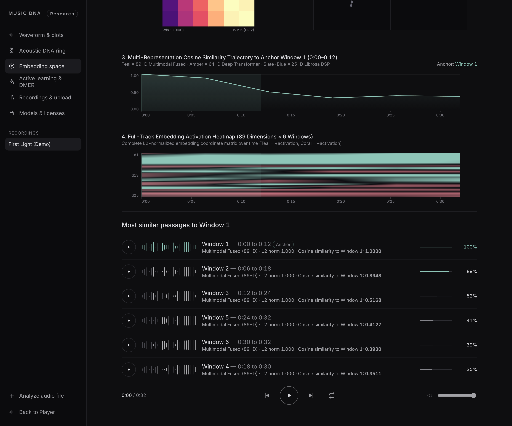

The parts the app is least sure about. These are the ones it would ask you about first:

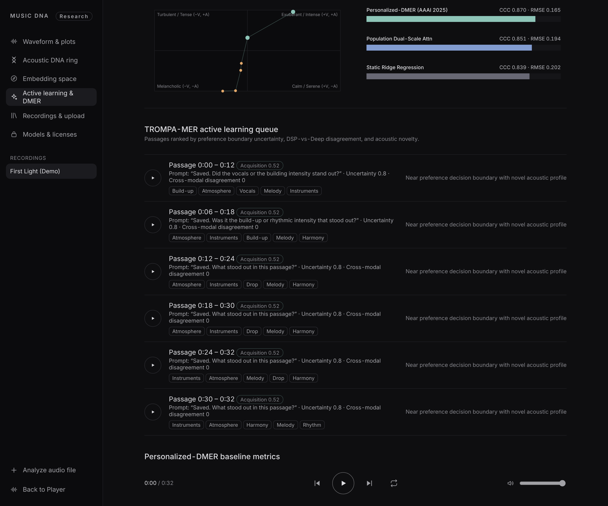

## Things it does not do

- It does not upload your music or your saved parts. They are stored in your browser, on your computer.
- It does not decide what you like from what you play. Only parts you saved or rated count.
- It does not analyse a song unless you allow it.

## How it is built

The player is a Vue 3 app (`index.html` → `src/main.ts`). Its look comes from the Music DNA design system in `reference/music-dna/design-system/` (colours, type, and components such as Waveform, SelectionToolbar, AskRow, TraitRing and PlaybackBar). Songs, saved parts and settings are stored in the browser's IndexedDB database (`music-dna-v1`). The analysis is done by a small Python program on the same computer. More in [docs/ARCHITECTURE.md](docs/ARCHITECTURE.md).

## Run

Requires **Node 20.19+** and a browser that can play the imported audio formats.

```bash
npm install
npm run dev
```

Open the local Vite address (typically `http://localhost:5173`). That is the player. The included **original, 32-second WAV recording** makes the player usable without importing music.

For authorized local music analysis, run the Python service in a second terminal:

```bash
python -m venv .venv
source .venv/bin/activate       # Windows: .venv\\Scripts\\activate
pip install -r requirements.txt
npm run service   # = uvicorn musicdna.service.app:app --port 8765 --reload: restarts itself when musicdna/ changes
```

In **Library**, import MP3/WAV or other browser-supported audio; press **Analyse locally** only if you have the necessary analysis rights (with automatic analysis off, the row asks you to confirm them first). Analysis is opt-in. Original recordings remain in the browser's IndexedDB; temporary analysis copies sent to your own localhost Python service are removed after processing. Streamed tracks are **not** assumed to be analyzable.

## Screens

- **Now playing:** real media playback, waveform from the decoded audio, seek, volume, drag-to-select, save, loop, ask row / describe strip, stem explore.
- **Library:** import audio, add from a link (YouTube / SoundCloud / direct, needs the local service), play, delete (with its moments), analyse locally (opt-in, rights confirmed in place), analysis status.
- **My Moments:** saved passages with tags and notes; play one, play a collection back to back, edit tags and note, remove. Collections: chills, home, melodies.
- **Discover:** suggestions from the personal ranker once a song is analysed and a moment saved; *I like it* / *Not for me* are stored as ratings and re-rank the list. Moments you return to can be saved or dismissed.
- **My Music DNA:** TraitRing + TraitRow. Shares come **only from qualities you named on saved moments**. Expand a trait to play its passages or *Correct* (remove that label from a moment). Learning switch, profile export.
- **Settings:** private listening insights, automatic analysis, volume, clear listening history, export profile.
- **Feature analysis:** service health, analysis windows with every measured value, active-learning queue, research baselines, held-out ranking. The full plots are in the research studio (`http://127.0.0.1:8765/studio`).
- **Implicit attention:** optional. User-initiated replays and loops may create attention hints. The player never records microphone audio or OS-level volume.

## Research separation

Detailed audio features, spectrogram-like analysis, acoustic plots, embeddings and held-out evaluation belong to the **Python research workflow**, not the listener UI:

```bash
pip install matplotlib  # optional, for images
python -m musicdna.experiments.acoustic_explorer public/demo.wav --out research-output
```

Outputs: `features.csv`, `segments.json`, and optional time-aligned acoustic plots. This uses the same `librosa` extractor as the API. The M3 contrastive personal ranker resides at `src/intelligence/personalize.ts`; the optional deep CLAP encoder requires **separately licensed local checkpoint weights**.

## Verify

```bash
npm test
npm run test:model
python -m pytest -q tests/python
npm run build
```

See `docs/ACCEPTANCE.md` for manual browser checks. `npm test` covers the Vue app's sources (routes, components, no Dexie in components, honest copy) and the framework-free rules in `src/core` (playback, listening log, DNA, Discover, diagnostics).

## Privacy and rights

Listening events are opt-in; active feedback and saved moments are explicitly user-created. Your music and preferences are local to your browser; the research analyzer runs on localhost only, not a remote service. The profile export omits the audio files. A playback entitlement or user upload does not automatically grant permission for commercial music analysis, AI training, or generative conditioning.
